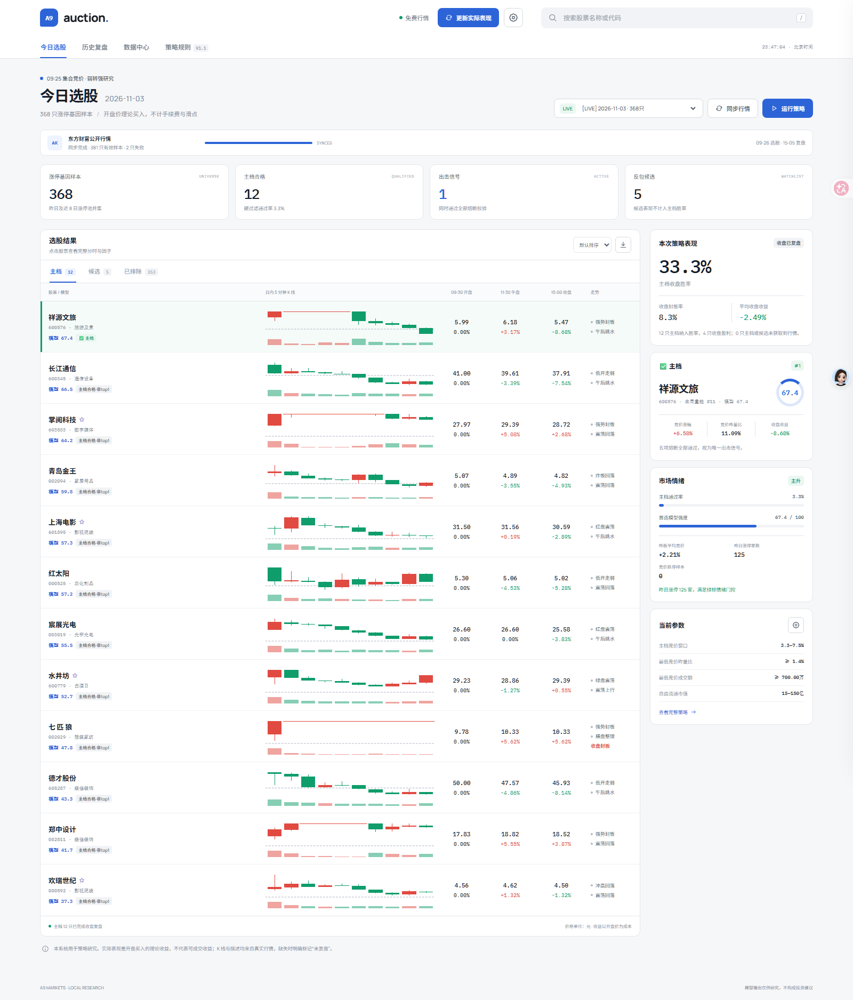
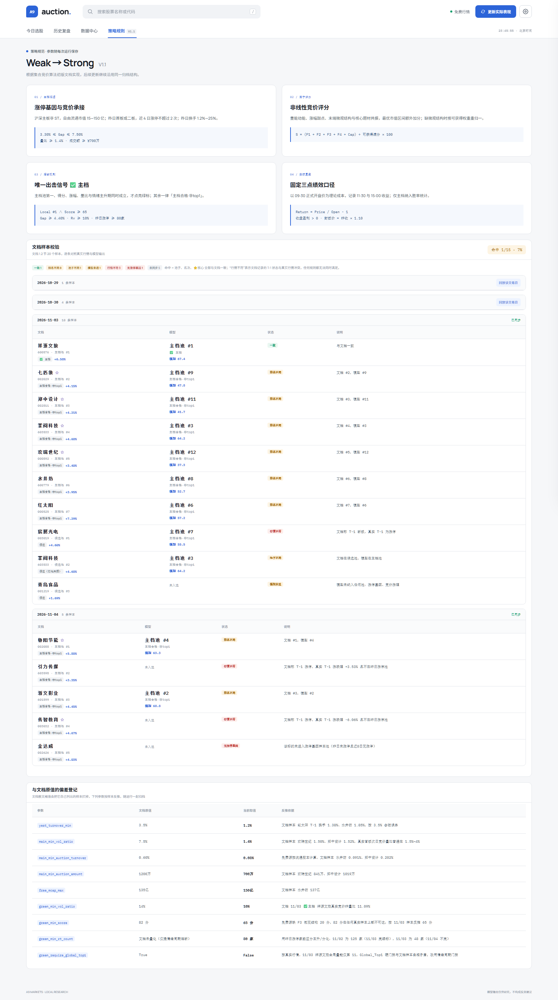
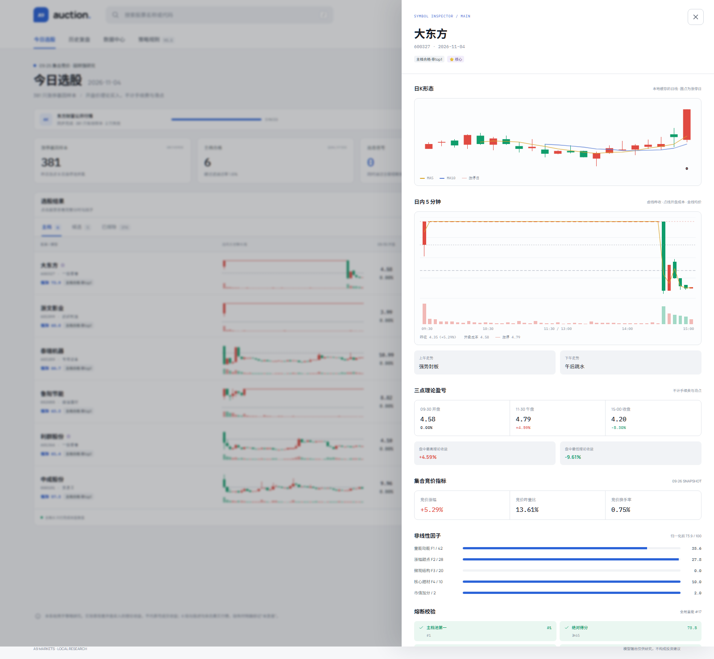

# 竞价·0925 选股系统（v2.2 · 自有算法）

一套 09:25 集合竞价「弱转强」选股 + 14:46 尾盘先手系统。Python + FastAPI 后端，纯静态前端，
数据来自 AKShare / 东方财富免费行情，本地 SQLite 归档。

**定位（2026-11-06 起）**：结构最初来自对某位发帖人算法的反推，参数用 10/29—11/06 的实盘样本标定，
但它现在是**一套自己的算法**——不再以「必须复现原帖名单」为目标。原帖的截图与名单只作为：
1. 参数标定的样本；
2. 表现对照的基准。
之后的迭代以实盘表现和自己的判断为准。

**当前算法要点**
- 主档（09:25）：近 12 日涨停基因 + 昨日连板 ≤ 2；竞价涨幅 3.0%—7.5%；竞价昨量比 ≥ 0.5%、竞价换手 ≥ 0.02%、成交额 ≥ 200 万；流通市值 15—250 亿；昨日换手 1.2%—35%。这组下限按文档 20 个主档样本反推，优先保证样本入池；要更严格的流动性门槛可在「策略参数」里调。
- 评分：`S = clamp(50 + 0.8 × (涨幅甜点 − 量比/换手/市值偏离 + 封单强度) + 末端抢筹, 0, 100)`，当前默认输出 Top 8（`main_pool_size` 可配 8—12）。区间因子在甜点区内不扣分、区外按对数距离扣分；末端抢筹只在 09:25 盘口可取时加分。
- 候选（09:26）：近 8 日涨停基因 + N 字反包 / 温和弱转强，不做连板高度限制；排序仍按量比×竞价换手×资金系数，展示分单调压缩到 0—100，输出 Top 12。
- 绿标：主档第一 + 得分 ≥ 65 + 竞价涨幅 ≥ 6% + 量比 ≥ 10% + 昨日全市场涨停 ≥ 80 家；全市场家数未知时按不通过处理。
- 稳健首选：主档池内找「涨停基因 ≥ 2、流通市值 ≥ 40 亿、竞价额 ≥ 1000 万」的票，再按收益优先分取最高的一只；找不到就输出“今日无稳健首选”，不把高风险 #1 硬当买点。每只票同时输出 `confidence` 与 `risk_flags`。
- 尾盘（14:46）：近 10 日涨停基因 + 今日 −3%~+4% 缩量洗盘 + 不破 5/10 日线 + 14:15—14:40 量占 09:30—14:40 累计量 ≥ 3%（14:46 时 14:45 后的 5 分钟线尚未完成）。
- 全程不含题材/概念因子；⭐核心 只用封单强度 / 连板高度 / 龙虎榜净买额判定。

## 11 月前向记分卡（只跟踪，不拟合）

`GET /api/forward/scorecard?since=2026-11-03` 只看 11 月以来的实际选股：

- 每个交易日取最新一次 run 的主档 Top8；
- 按当日开盘买入、T+1 收盘卖出，扣当前成本；
- 2026-11-03—11-11：**7 个交易日、54 笔，平均 +0.58%、胜率 46.3%**；
- 同日 Top12 因 11-11 多纳入 4 只亏损票，平均约 **+0.30%**；Top8 确实优于 Top12。

| 日期 | Top8 平均 | 胜率 |
| --- | ---: | ---: |
| 11-03 | −1.37% | 37.5% |
| 11-04 | +2.08% | 37.5% |
| 11-05 | +1.05% | 50.0% |
| 11-06 | −0.74% | 50.0% |
| 11-09 | +4.73% | 75.0% |
| 11-10 | −0.16% | 37.5% |
| 11-11 | −1.85% | 25.0% |

这是 7 天样本，只能说明“当前窗口 Top8 暂时为正、Top8 比 Top12 好”，不能当成长期胜率。后续每天用这个接口前向累计，不再用 2020—2026 历史拟合。

## 2020+ 本地历史回测

`backend/history_backtest.py` 用本地 1 分钟 parquet（2020-01-01—2026-09-11）聚合日线、09:30 竞价与 09:35 首根 5 分钟，按 `main_reasons` + `score_main` 选股，再用不同排名/买入时机计算扣费后的收益。

- 运行：`python -m backend.history_backtest`
- 缓存：`data/history_panel_2020.parquet`
- 样本：455 只主板股票、24,788 个股票日、2,531 个主档合格信号（2020—2026）
- 局限：本地 parquet 没有流通股本/换手率，用当前数据集的流通股本做静态代理；是相对排名回测，不是逐笔成交回测。

**结论（扣 0.3% 滑点 + 0.026% 佣金 + 0.05% 印花税）**：主档信号按开盘买入平均 **−1.23%**、胜率 **43.8%**；按 09:35 首根 5 分钟买入平均 **−1.17%**、胜率 **33.8%**；按 09:31 买入平均 **−1.00%**、胜率 **40.2%**；按“09:35 回落 −1%—0%”买入平均 **−0.87%**、胜率 **37.5%**。按分数、涨幅、量比、基因、竞价额、首 5 分钟等 15 种排名逐一测试，没有一种在 2020—2026 全样本稳定为正；少数小市值/高换手/深回踩子集在个别年份为正，但样本少且跨年不稳定，未写入默认参数。

### 宽口径替代策略测试

为避免只看“竞价高开”内部，新增 `data/history_panel_wide.parquet`：**987 只、1,462,823 个股票日、gap −5%—+10%**，覆盖低开/平开/高开。

按 T+1 收盘卖出测试：

- 全部样本：平均 **−0.54%**、胜率 38.6%
- 低 gap 分位：**−0.35%**、胜率 44.4%
- 低 5 日动量分位：**−0.30%**、胜率 45.5%
- 高量比/高换手分位：约 −0.38% ~ −0.48%
- 09:35 强势分位（事后分组）：T+1 开盘买 +1.69%，但按 09:35 实际买入为 **−0.36%**

**没有找到任何 long-only、T+1、扣费后为正的因子分位。** 最好的低 gap/低动量分位仍是负值；这不是把阈值往左或往右调一格能解决的。


这不是“再调一个阈值”能解决的问题：当前“竞价高开 + 12 日涨停基因”在这个样本里没有正期望。默认排名不做单日名单硬编码或过拟合；回测脚本保留，后续换因子/换市场先在这里验证。

### 免费新增数据：T-1 龙虎榜

`backend/alt_data.py` 用 AKShare `stock_lhb_detail_em` 按年批量抓取，缓存 `data/lhb_2020_2026.parquet`：

- 2020-01-02—2026-09-11
- 104,589 条龙虎榜明细，按代码/日期合并为 `lhb_prev`
- 已加入 `model_research.py` 特征；`sync_market` 也继续补 T-1 龙虎榜

验证结果：主档合格样本中，T-1 龙虎榜净买入 >0 的 496 笔，次日收盘净收益 **−1.79%**、胜率 37.1%；净卖出 122 笔 **−0.42%**、胜率 44.3%。加入模型后 Top1 仍为 −1.32%。  
**结论：龙虎榜是免费可得的，但它没有把当前策略变成正期望；已接入但未作为默认加分项。**

### 免费数据边界

| 数据 | 免费可得 | 说明 |
|---|---|---|
| T-1 龙虎榜 | 是 | 按年批量，已接入 |
| 指数日线 / 市场 regime | 是 | 腾讯/新浪日线，可做大盘过滤 |
| 行业/概念历史 | 部分 | AKShare 有接口，但东财板块 host 当前经常断连 |
| 历史 09:25 逐笔/未匹配委托 | 否 | 免费源只有实时 09:25 盘口快照；历史 L2 需付费 |
| 历史资金流 | 部分 | 单股接口约 100 天；全历史需付费/逐只抓取 |


## 2026-11-10 复核修复

- 评分：修正 `f1/f2/f3/f4` 字段名与前端 `/8` 上限错位；原始公式保留（样本次序不变），明细改为带正负号的贡献表；`band_penalty` 对 0 值不再当作“落在甜点区”；末端抢筹按真实盘口加分，缺失时明确标注“未计分”。
- 口径：默认参数与校准表、规则页一致（量比 0.5%、竞价换手 0.02%、成交额 200 万、市值 250 亿、得分 65、情绪 80 家）；这组下限按文档样本反推，优先保证样本入池。`zt_count_8` 改为真正的 8 日，新增 `zt_count_12` 供主档使用。
- 绿标：全市场涨停家数缺失时 fail-closed，不再用样本内数量冒充。
- 池子：主档/候选截断后，通过硬过滤但名次靠后的股票进入“已排除”并标注“主档名额/候选名额”，不再凭空消失；文档样本页新增“名额外”状态。
- 候选：排序仍按量比×竞价换手×资金系数，展示分改为 0—100 的单调压缩，修复 181.7 与 0.1 并排的显示问题。
- 尾盘：盘中、回放、回测共用同一个评分函数；四条轨道评分构成固定 100 分；点火收盘位置统一为 96%；尾盘窗口统一为 14:15—14:40；缓存版本升级，旧快照自动失效。
- 绩效：复盘任务改用 Asia/Shanghai 日期；尾盘回测修正次日基准、14:15—14:40 口径，并同时返回毛收益与扣费净收益。
- 数据：CSV 模板补齐 12 日基因、全市场涨停家数、题材字段；`is_zt` 留空按 False 处理。
- 兼容：历史 `runs.result` 保留旧评分字段，前端详情抽屉可回退展示；新运行写入 V2.1 的 `score.factors`。2026-11-10 已按新规则重跑最新交易日，历史上仍保留旧记录。

## 2026-11-11 前向复盘与算法调整

用 11/03—11/10 的真实日线，以 09:25 竞价价买入、次日收盘卖出，扣同一套成本：

| 口径 | 可评估 | 次日收盘净收益 | 胜率 |
| --- | ---: | ---: | ---: |
| 早盘主档 Top8（当时默认） | 38 | +1.77% | 52.6% |
| 早盘模型 #1 | 5 | −4.30% | 20.0% |
| 早盘收益优先 #1 | 5 | **+5.17%** | 60.0% |
| 早盘模型 Top3 | 15 | −1.42% | 33.3% |
| 早盘收益优先 Top3 | 15 | **+5.95%** | 66.7% |
| 早盘 #5—#8 | 13 | +1.8%～+10.5% | 50%～75% |
| 早盘候选池 | 59 | +0.53% | 47.5% |
| 尾盘 11-05（信号日） | 18 | −2.42% | 22.2% |
| 尾盘 11-06（信号日） | 20 | +1.70% | 45.0% |

结论：**评分第一目前是负向的，真正有效的是“评分第一 + 风险过滤”而不是无脑 #1**。11/03—11/10 次日收盘净收益最高的样本：东方海洋 +19.1%、永臻股份 +17.8%、引力传媒 +17.1%、光洋股份 +15.9%、浙文影业 +15.8%、锋龙股份 +15.1%、春光科技 +14.8%、冰山冷热 +14.8%、鲁阳节能 +14.3%、郑中设计 +14.2%。最差样本：泰瑞机器 −14.9%、澳洋健康 −11.0%、祥源文旅 −10.4%、广聚能源 −9.9%、金陵药业 −9.3%。

因此新增 **稳健首选**：在当前主档池内找「涨停基因 ≥ 2、流通市值 ≥ 40 亿、竞价额 ≥ 1000 万」的票，再按收益优先分取最高的一只；找不到就明确输出“今日无稳健首选”，不把高风险 #1 硬当买点。样本内 5 个可评估的稳健首选：掌阅 +7.0%、鲁阳 +13.5%、桂林 −2.4%、阳光 +2.4%、光洋 +15.1%，平均 **+7.11%**、胜率 80%。同时输出 `confidence` 和 `risk_flags`（基因弱、市值小、竞价额低、竞价换手 0.5%—1.0%、昨日换手 ≥30%、量比 ≥50%、连板过高），前端详情直接展示。

同时新增 **收益优先分 `return_score` / `return_rank`**：横截面按基因次数、非昨日涨停、低量比、大市值、高昨日换手加权。模型排名和收益优先排名同时保留；表格默认按“收益优先”排序，`score`/`model_rank` 仍在详情和 CSV 里。11/03—11/09 可评估主档内，模型 #1 平均 −4.30%，收益优先 #1 平均 **+5.17%**；模型 Top3 平均 −1.42%，收益优先 Top3 平均 **+5.95%**。这是小样本研究结果，下一阶段继续用 walk-forward 验证。

### 情绪与板块的处理

新增 `backend/sentiment.py`：用本地日线计算涨停/跌停家数、晋级率、炸板率、涨跌宽度、成交额、最高连板，并对自身 60 日历史取分位，合成 0—100 情绪温度；权重按公开复盘框架：晋级率和炸板率最高，连板高度、跌停家数、成交额作辅助。`GET /api/sentiment?day=` 可直接查。

情绪目前**只作为环境提示和仓位提示，不直接进个股排名**。原因：11/03—11/11 的 5 天样本里，高情绪日（11-03、11-05）次日个股表现并不稳定，低情绪日（11-09）反而出了较多正收益；把情绪当正向加分容易反过来追高。当前只在 `market.sentiment` 和 `position_hint` 里提示“主升/分化/退潮/冰点”。

`position_factor` 采用风险感知的启发式：≥80 → 0.5，60—80 → 0.7，40—60 → 1.0，30—40 → 0.8，<30 → 0.4。它不是回测出来的最优仓位权重，只是把“高情绪拥挤、冰点等待”落到一个可执行的系数上；后续应用真实收益校准。

板块/概念数据（`theme_limit_ups`、`theme_density`、`concept_limit_ups`）在本地 5 天样本里与次日收益呈**负相关**（主档约 −0.29 ~ −0.38），更像“拥挤度”而不是“动量加分”。因此目前只把“题材涨停 ≥10 家 / 密度 ≥15% / 同行业涨停 ≥10 家”作为 `risk_flags` 的 crowding 扣分，不加入 `return_score`。这与概念动量文献的月度结论不冲突：月度概念动量 ≠ 次日竞价接力；短周期更可能是拥挤反转。

尾盘结论：11-05 所有轨道次日均负，11-06 地板反核/点火转正；当前样本不足以给任何轨道打“已验证”标签。尾盘已改为**轨道内百分位合并**、参数集中、盘中/回放/回测共用评分，并新增 `GET /api/closing/scorecard` 持续记录每条轨道的次日表现，暂不因为一天的正负收益硬改轨道权重。

11-11 晚帖的 9 只主档样本已加入 `DOC_SAMPLES`。当前默认 Top8 命中 4 只：日海智能 #1、天奇股份 #3、新北洋 #4、泰尔股份 #8；凯撒文化 #11、传智教育 #12、德尔未来 #19 通过硬过滤但名额外，金杯汽车进入候选池；神开股份不在 12 日收盘涨停基因池（本地也没有它的日线），已加入帖子观察池，但本次数据集仍显示 `watch_missing`。这是当前“Top8 截断 + 12 日收盘涨停基因池”的边界，不是评分公式报错。11-11 实际封板的是日海智能、凯撒文化、传智教育、神开股份；Top8 抓到 1/4，说明下一步最该补的是**入池覆盖与名额外观察**，而不是继续调评分权重。结果 API 与前端新增 `overflow` / “名额外”视图，专门列出通过硬过滤但落在 Top8 外的票（11-11 含凯撒 #11、传智 #12、德尔 #19），不再只躺在“已排除”里。

早盘前向基线：`GET /api/backtest/morning?top=12`，返回按名次、收益优先排名和 `preferred` 分组的收益；尾盘用 `GET /api/closing/scorecard?dataset_id=<id>`。

### 买入信号引擎（已移除）

选股结果不再输出 `buy_plan`，也不生成 09:30—09:35 的精确买入时间；因为大样本回测没有正期望。以下旧说明（价格区间、5 秒监控、09:35 回测）只保留作研究记录，不参与选股输出。

- 09:25 生成，09:30—09:35 执行
- 买入区 = 拍卖价 × [1.00, 1.02]
- 放弃价 = 拍卖价 × 0.98
- 止损 = 拍卖价 × 0.98
- 触发条件：进入买入区且站上当日均价线；高于上沿不追，等回踩
- 09:35 仍未触发自动取消

> 2020—2026 本地 1 分钟回测显示，这个确认区扣费后没有正期望（见「2020+ 本地历史回测」）；下面的买入/监控只作为研究执行链，不应视为可盈利策略。

`backend/signals.py` 在 09:25—09:40 每 5 秒拉腾讯行情，生成 `WAIT / BUY / ABORT / CANCEL / STOP` 事件并写入 SQLite `signals` 表。自动任务 09:27 启动；页面在监控窗口内显示“开始 09:30 监控”，并每 10 秒刷新状态。监控只盯 `preferred` 和收益优先前 3 名（通常 3—4 只），其余计划只展示不报警，避免 18 只票同时刷屏。

API：

- `GET /api/signals`：当前计划、状态、事件、历史
- `POST /api/signals/start`：手动启动（仅 09:25—09:40）
- `POST /api/signals/stop`
- `GET /api/timing/backtest?run_id=<id>`：用本地 5 分钟线粗测“09:35 开盘确认”

本地 1 分钟样本 31,664 条（2026-01—09，主板，gap 3%—7.5%）的结论：

| 09:35 相对开盘 | 样本 | 收盘相对开盘均值 | 收盘上涨概率 |
| --- | ---: | ---: | ---: |
| < −2% | 78 | −2.90% | 20.5% |
| −2% ~ −1% | 62 | −1.36% | 27.4% |
| −1% ~ −0.5% | 41 | −0.96% | 31.7% |
| −0.5% ~ 0 | 61 | +0.11% | 26.2% |
| 0 ~ +0.5% | 41 | +0.89% | 56.1% |
| +0.5% ~ +1% | 31 | +1.05% | 67.7% |
| +1% ~ +2% | 55 | +2.03% | 80.0% |
| > +2% | 77 | +2.14% | 79.2% |

负承接的当日收益明显更差，>+2% 再追的“09:35 后买入”收益转负；所以计划改为不买负承接、不追 +2% 以上。精度只到 09:35，实盘监控是 5 秒，不能把 5 分钟回测当成逐笔成交。

### 09:25 时点与帖子观察池

- 自动同步在交易日 **09:26:15**；当日手动同步在 09:26 前会被拒绝（`集合竞价尚未结束`），不会用 09:24 的参考价出票。
- 09:24 的价格只是“末段跳升”参考；选股价格是 09:25 撮合价，详情里同时显示 `竞价数据时间 / 竞价来源`（盘前 09:26 帧或 09:30 一分钟 K 线）。
- `backend/post_watchlist.py` 保存帖子选中但可能不在 12 日涨停池的代码（当前：神开股份 002278、新炬网络 605398）。同步时强制并入股票池并抓日线/竞价；结果 API 多一个 `watchlist` 列表。
- 帖子观察票如果通过硬过滤会进入主档/候选；没通过会显示在“已排除”并带“帖子观察”标签；`doc-check` 新增 `watch`（已补入但未通过硬过滤）和 `watch_missing`（补抓后仍无行情）两种状态。

## 交易成本口径

收益默认按「开盘价买入 → 卖出」计算，扣除：

- 双边滑点 0.30%（`slippage_pct`，可配置）
- 佣金/过户费 0.026% 单边（`fee_pct`）
- 卖出印花税 0.05%（`stamp_duty_pct`）

往返成本约 0.70%，净收益 = 卖出到手 ÷ 买入成本 − 1。表里的「收盘盈亏」、绩效卡、历史复盘和
CSV 的 `*_return_net` 列都是净收益；K 线与价格列仍是真实成交价。参数在「策略参数」里可改。

## 尾盘选股（14:46）

- 展示与早盘同一套：股票行 + 日内 5 分钟缩略图，点开是分时、规则检查、评分构成和日 K。
- **一个候选列表 + 轨道标签**：全部 / 缩量回踩 / 地板反核 / 点火 / 强势反包。旧「缩量回踩」只是其中一条轨道，
  不再单独决定尾盘选股。
- 扫描时点对齐发帖人的 **14:46**；「尾盘量能」用 **14:15—14:40 的成交量 ÷ 09:30—14:40 累计成交量**
  （14:46 时 14:45 之后的 5 分钟线还没走完；旧的「14:45 后 ≥3%」在 14:46 根本无法计算）。
  回放与回测使用同一口径，避免盘中 / 历史两套阈值。
- 地板反核：盘中触板/深跌后**仍在低位**（距低点 ≤3%）即可，不等它收回；这正是 11-06 14:46 的文投
  （价格 2.29，低点 2.28，距低点 0.44%）。
- 点火不要求涨停基因，从**全市场快照**补候选并按需拉日线；收盘位置门槛放宽到 96%（东方环宇 14:46 是 96.5%）。
- 四条轨道都要求「尾盘量能 ≥3%」和「未封板（涨幅 <9.5%）」，保证 14:46 买得到；评分构成固定为 100 分，
  盘中、回放与回测共用同一个评分函数。
- **跨轨道不再直接比原始分**：每条轨道先在本轨道内排名并换算百分位，「全部」列表按轨道百分位合并，
  同百分位才用原始分做次级排序；同一只票命中多条轨道时会显示全部轨道标签。这样地板反核的高深度分
  不会天然压过点火的放量分。
- 规则参数集中在 `backend/main.py` 的 `CLOSING_RULES`，随快照写入 `rule.params`；改阈值只改一处，
  盘前预筛、规则检查和回放共用。
- 迭代反馈：`GET /api/closing/scorecard?dataset_id=<id>` 按 14:46 回放价统计每条轨道到收盘/次日开盘/次日收盘的净收益；
  `GET /api/backtest/morning?top=8` 统计早盘主档前 N 名的前向收益。两者都扣同一套交易成本。
- 快照持久化到 `data/closing_snapshot.json`：重启后第一次打开也是 0.1 秒级；盘中快照超过 60 秒
  只在尾盘窗口内后台重算，不阻塞页面；14:46 定时快照；「重新扫描」强制重算。
- 窗口外打开会标注「最近快照 + 时间」，不会为了没有意义的结果让你等十几秒。
- **历史回放**：尾盘页右上角可选「实时 · 11-09」或「回放 11-06 / 11-05 / …」。回放用当天日线预筛，
  再用当天 5 分钟线重建 14:46 状态；结果按天缓存（首次约 2—5 秒，之后 0.05 秒）。
  - 11-06 回放：文投控股 地板反核第 1，东方环宇 点火；11-05 回放：光洋股份 强势反包第 1。
  - 股票池 = 当天及之后交易日的数据集（它们的日线覆盖当天）+ 帖子样本；历史全市场点火暂只覆盖
    本地有日线的股票和样本，不是完整全市场（没有历史全市场快照）。
- 页面底部「发帖人尾盘样本（11/05—11/06）」按 14:46 复核发帖人的三只票。
  **文投是 11-06（周五）选的、光洋是 11-05（周四）选的、东方是 11-06（周五）选的；11-09 只是兑现日。**

  | 股票 | 信号日 14:46 | 轨道 | 之后表现 |
  | --- | --- | --- | --- |
  | 文投控股 | 11-06（周五）价 2.29（−9.13%），低点 2.28（−9.52%），距低点 0.44%，量比 0.58×，站上 MA10，涨停基因 5，最后 30 分钟量能 11.7% | 地板反核 | 11-09 +10.21% |
  | 光洋股份 | 11-05（周四）价 20.61（+5.48%），低点 17.94（−8.19%），距低点 14.88%，量比 0.79×，涨停基因 4，最后 30 分钟量能 3.7% | 强势反包 | 11-06 −3.48% 洗盘，11-09 +10.02% |
  | 东方环宇 | 11-06（周五）价 18.10（+4.93%），放量 5.19×，收盘在当日 96.5% 位置，最后 30 分钟量能 5.9% | 点火 | 11-09 +10.03% |

  这三条是**规则校验**，不参与 11-09 的买入排序；11-09 当天它们已经封板，不是新的 14:46 信号。
- 冷扫描约 18 秒（全市场快照 + 主列表与轨道候选并行取 5 分钟线），命中快照 <0.1 秒；
  `GET /api/closing?refresh=1` 强制重算。

## 启动

装好 Harness 插件后，直接点侧边栏「选股」→「一键启动」即可，不需要执行下面的命令。

```bat
start.bat            # 首次会建 .venv 并安装依赖，然后打开 http://127.0.0.1:8000
```

或手动：

```bash
python -m uvicorn backend.main:app --host 127.0.0.1 --port 8000
```

## 证据口径（很重要）

- **算法输出** = 截图里的「名单 / ⭐核心 / 主档标签 / 名次 / 现价涨幅」，这些是硬约束，用来反推和校验。
- **市场观点** = 帖子正文（为什么看好某只、谁是真龙头、跨年妖股…），属于发帖人的判断，**不作为算法因子**。
- 两者冲突时以截图为准；正文只用来理解他的操作节奏（比如“竞价选完就上班、尾盘再选一次”）。

## v1.2 相对上一版改了什么

### 1. 选股逻辑按文档对齐（backend/strategy.py）

| 位置 | 上一版 | 现在 |
| --- | --- | --- |
| 标签 | 出击信号 / 主档合格 | 文档口径：`✅ 主档` / `主档合格·非top1` / `⭐ 核心` / `候选` |
| 绿标熔断 | 多了一个"市场情绪正常"的隐藏条件 | 文档 5.1 的四条 + 情绪周期门控，逐条显示通过与未通过 |
| 缺微观结构 | F3 直接记 0 分，导致 82 分线永不可达 | 末端抢筹改为可选加分；缺失时明确标注“未计分”，不伪造成 0 分或满分 |
| 流通市值 | 直接用涨停池的流通市值 | 用昨日成交量 / 换手率反推流通股本 × 收盘价；字段名保留 `free_market_cap` 兼容旧数据，但页面统一标为“流通市值（换手推算）” |
| 一字板过滤 | High>Low 无条件剔除 | 只有"振幅为 0 且换手不足"才剔除（否则 11/04 浙文影业会被误杀） |

### 2. 阈值按文档样本反推（页面上可见「与文档原值的偏差登记」）

文档散文里的阈值会把它自己列出的实盘样本全部拦掉，例如：

- 竞价昨量比 ≥ 7.5%：文档样本 欢瑞世纪真实只有 1.50%、郑中设计 1.52%
- 昨日换手 ≥ 3.5%：文档样本 水井坊 1.85%、红太阳 1.38%
- 竞价换手 ≥ 0.60%：文档样本 水井坊 0.091%、郑中设计 0.202%
- 绿标得分 ≥ 82：免费源没有 F3 的 20 分，82 分在所有真实样本上都不可达

所以按样本取最小值反推，全部登记在 `backend/strategy.py` 的 `CALIBRATIONS`，
每次运行随结果归档，策略规则页直接展开。

### 3. 新增「文档样本校验」（策略规则页 / `GET /api/doc-check`）

`backend/doc_samples.py` 把文档 1.2 节样本与后续帖子样本做成机器可读清单（当前 43 条，含 2026-11-11 晚帖 9 条），
逐条对照**真实行情**和**模型输出**，给出 一致 / 排名不同 / 池子不同 / 名额外 / 行情不符 / 无涨停基因 / 帖子观察缺行情 / 未同步。
"行情不符"意味着文档记录的 T-1 状态与真实行情冲突——这种样本任何规则都不可能同时满足，需要改文档而不是改代码。

当前的两天真实数据：

- 2026-11-03：文档主档池 7 只全部进入模型主档池，第一名 `祥源文旅` 点亮 `✅ 主档`，与文档一致
- 2026-11-04：`浙文影业` #2、`鲁阳节能` #4 进入主档池，当日不亮绿标（昨日涨停仅 48 家），与文档"未选出票"一致；
  但文档声称 T-1 涨停的 `引力传媒`（真实 +3.53%）、`传智教育`（真实 -6.06%）、`金达威`（近 8 日无涨停）在真实行情里根本不具备昨日涨停基因

### 4. K 线重做

- 列表缩略图：日内 5 分钟 K 线，A 股口径红涨绿跌，带成交量柱、昨收虚线、涨停虚线
- 详情抽屉：新增本地缓存的日 K（MA5/MA10/涨停日标记），日内图带均价线与开盘成本线
- 修掉旧版：颜色反了（绿涨红跌）、`preserveAspectRatio=none` 把 1px 蜡烛拉成黑线、无量能、无参考线

### 5. 历史交易日回放

`POST /api/market/sync {"trading_day": "2026-11-03"}` 可以回放最近 15 个交易日。
免费分钟接口只有最近若干天，回放时用 **09:30 一分钟 K 线**取集合竞价量价（已逐只与盘前 09:26 接口比对一致），
此时没有盘口微观结构，评分会自动重归一并在数据质量里标注。

### 6. 非实时交易日的价格列

`现价 / 涨幅` 以前在拿不到实时报价时直接回退成 `开盘价 / 开盘涨幅`，所以周末或看历史交易日时
四列会「两两相等」，`收盘盈亏` 还会显示成固定的 −0.6%（双边滑点）。现在取数顺序是：
**实时报价 → 已复盘收盘 → 当日最后一根 5 分钟线（即当日收盘）→ 当日日线**，都没有就显示「—」；
非实时数据的表头把「现价」改称「收盘价」。切换数据集会清掉上一份报价 / 分钟 / 日线缓存，避免串日。

## 每天更新流程

1. 收盘后把 guru 帖子里新的一天截图内容追加到 `backend/doc_samples.py` 的 `DOC_SAMPLES`
2. 打开系统 →「策略规则」→「回放该交易日」
3. 看「文档样本校验」的命中率和每条差异说明
4. 若差异来自阈值而不是数据，改 `CALIBRATIONS` 和 `StrategyConfig` 默认值，并在这份 README 里记一笔

## 数据边界（免费源）

多源免费行情，不需要 API Key：

| 字段 | 来源 | 口径 |
| --- | --- | --- |
| 本地 1 分钟 parquet | `E:/BaiduNetdiskDownload/stock_1min`（可用 `STOCK_1MIN_DIR` 改） | 约 72GB，覆盖到 2026-09-11；回放/复盘优先读本地，超出覆盖再回退 AKShare |
| 竞价量价 | 东方财富盘前接口 / 09:30 一分钟 K 线 | 09:25 撮合那一笔；回放时用 09:30 分钟线 |
| 09:24:45 快照 | 东方财富 09:24 分钟收盘 | 近似值，没有 45 秒粒度 |
| 买一未匹配量 | 腾讯行情五档盘口 | 只在 09:25:10—09:30 的同步窗口抓取；窗口外为空 |
| 5 日主力净流入 | 东方财富资金流排行（一次全市场） | 只对最近交易日有效；历史回放不补，避免未来数据 |
| 龙虎榜净买额 | 东方财富 T-1 龙虎榜 | 未上榜为 0 |
| 题材涨停家数 | 本地概念成分 × 昨日涨停池 | 近似，不是实时板块行情 |
| 全市场宽度 | 东方财富全市场快照 | 涨跌家数 / 涨跌停 / 成交额，60 秒缓存 |

本地 1 分钟数据可用 `GET /api/minute-data/status` 查看文件数/最新日期；`GET /api/minutes/{code}?day=YYYY-MM-DD` 在覆盖范围内优先读本地 parquet，否则回退 AKShare。回放/复盘（`performance.fetch_minutes`、尾盘回放/回测）同样优先本地数据，见 `backend/minute_store.py`。

- 买一未匹配量进入 `unmatched_ratio`；5 日资金流进入候选资金系数（`1 + inflow / 5亿`，夹在 0.1—2.0）；
  T-1 龙虎榜净买额 ≥ 2000 万会把 `is_core` 点亮为「资金主攻方向」。
- 已有数据集可以在「数据中心 → 补齐资金流/龙虎榜」补字段；回放旧日期只补龙虎榜。
- CSV 与演示数据不会补这些字段，也不伪造走势。

**同步容错**：
- 东方财富/腾讯/Sina 默认加入 `NO_PROXY` 直连，避免本机代理断开时报 `ProxyError`；需要强制代理时设 `QUANT_KEEP_PROXY=1`。
- 网络调用 5 次指数退避重试；近 12 日涨停池并发抓取，单日失败只记录，不拖垮整次同步。
- 同一交易日已有 ≥300 只样本的数据集时直接复用，不重复抓取；失败后重启也不会把已成功的数据集再打一遍。
- 历史回放优先用本地 09:30 分钟线代替盘前接口；缺失时依次回退 Sina 1 分钟（09:31 开盘近似）、东财 1 分钟、AKShare。
- 日线失败时回退腾讯日 K；缺成交额/换手用当前流通股本估算，并在 `data_quality` 标注。


## 界面

| 今日选股 | 文档样本校验 |
| --- | --- |
|  |  |

| 个股详情（日K + 日内5分钟） |
| --- |
|  |

## Harness 插件（侧边栏选股）

`dsh-quant-panel/` 把这套系统接进 DeepSeek Harness Web GUI：左侧边栏多一个「选股」图标，
点一下切到选股界面，点右上角 × 或侧边栏对话图标回到会话。

- 面板通过 Harness 自身的 Web 服务暴露在 `/quant`（同源反向代理到 127.0.0.1:8000），
  页面里的 `/static`、`/api` 会被改写到 `/quant` 下，所以不需要 CORS，也不受跨源 frame 策略影响。
- **一键启动**：后端没起来时面板直接显示「一键启动」，Host 半边会自动找 Python、拉起 uvicorn、
  等就绪后切到选股界面；日志在 `data/backend.log`，不需要再开命令行。
- 后端没启动时面板每 30 秒自动重连；启动后无需重启 Harness。
- 安装 / 卸载：`plugin_manager install_bundle` / `remove_bundle`，目标 `@local/dsh-quant-panel`。
- 细节见 [dsh-quant-panel/README.md](dsh-quant-panel/README.md)。

## 目录

```
backend/    strategy.py 选股与评分 / market_data.py 同步 / performance.py 复盘 / doc_samples.py 文档样本
frontend/   index.html app.js styles.css（无构建步骤）
data/       quant.db（SQLite，含日线缓存）
dsh-quant-panel/  Harness 侧边栏插件（Host 代理 + Client 面板 + 图标/文案）
```
